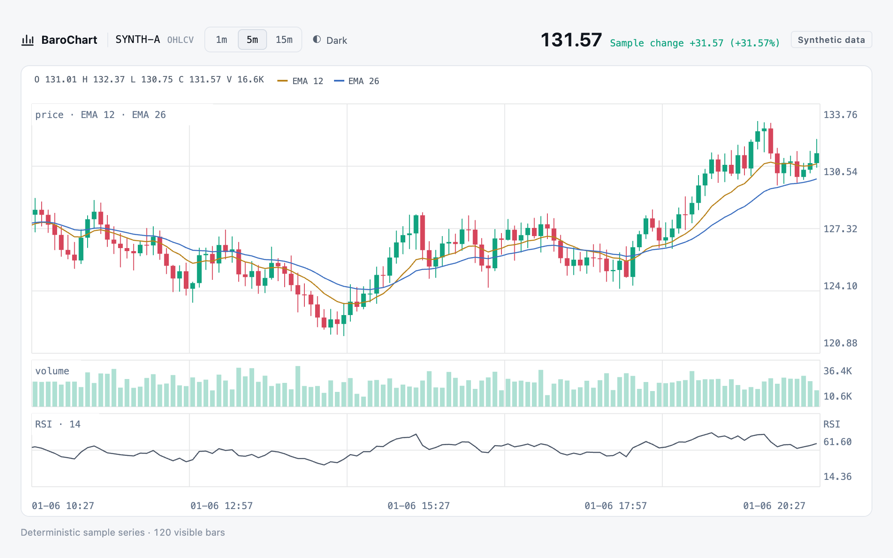
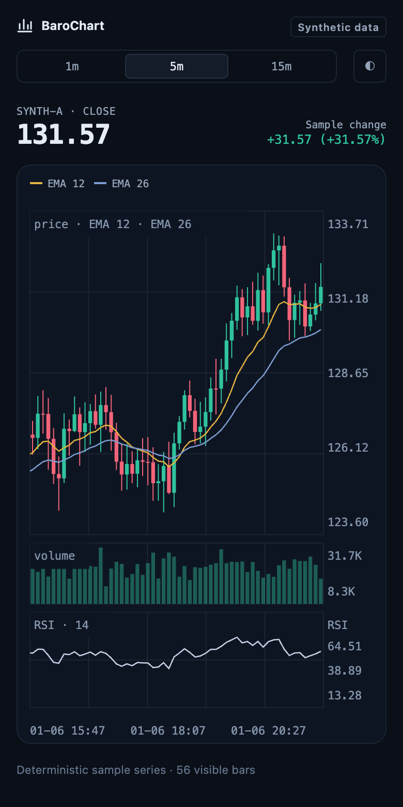
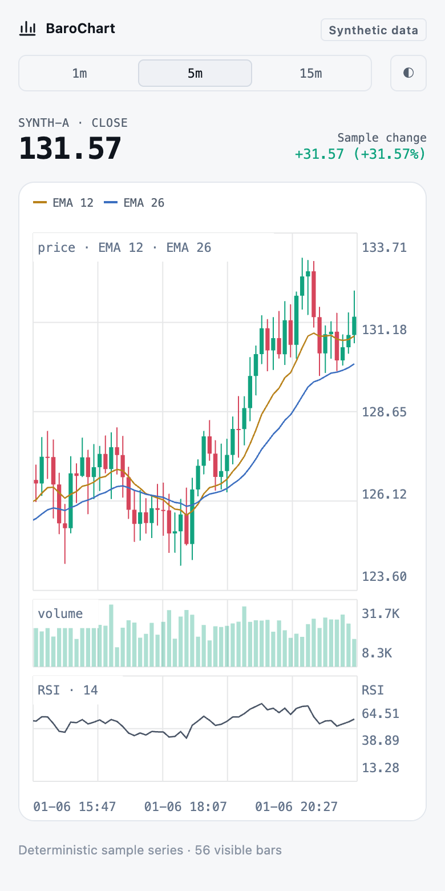
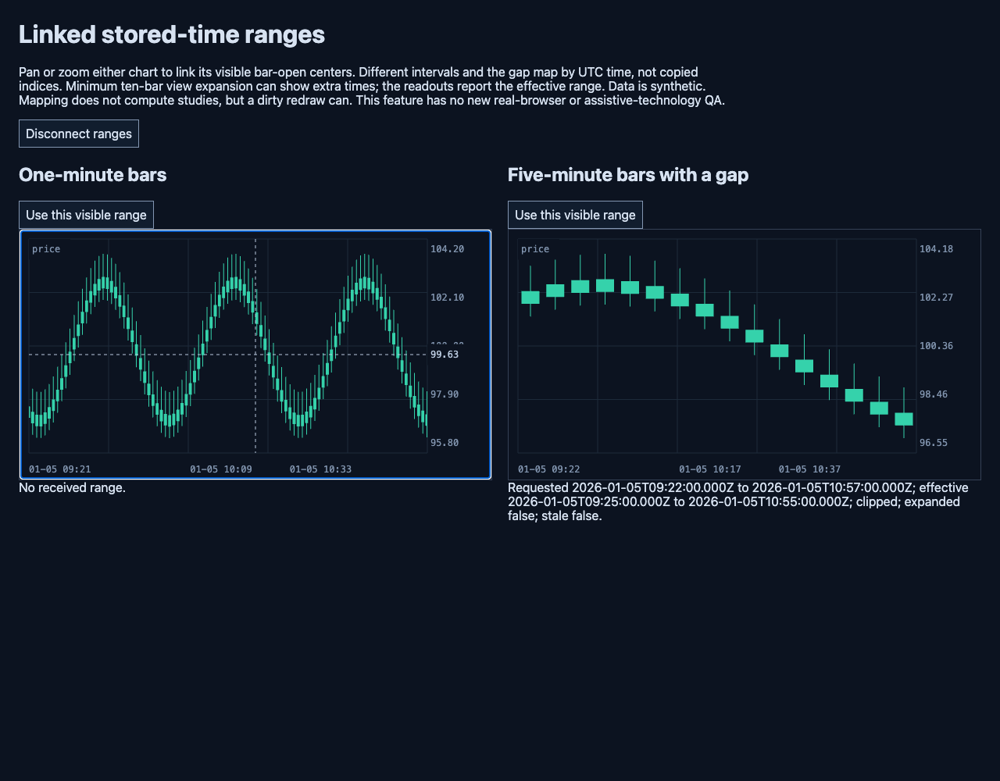
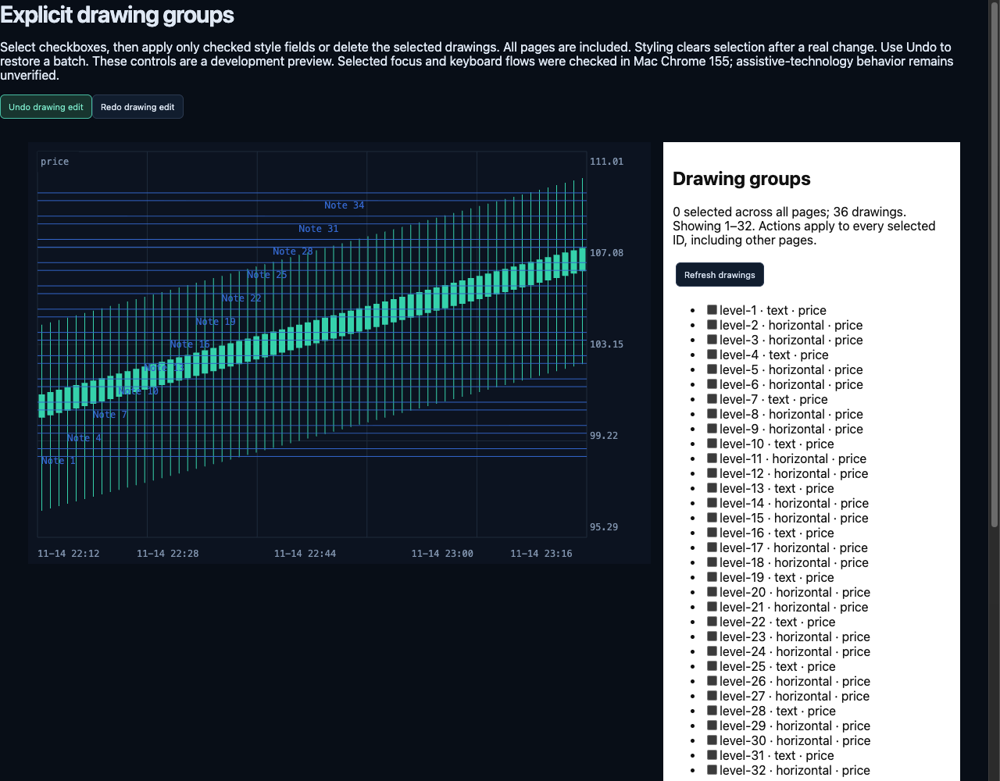
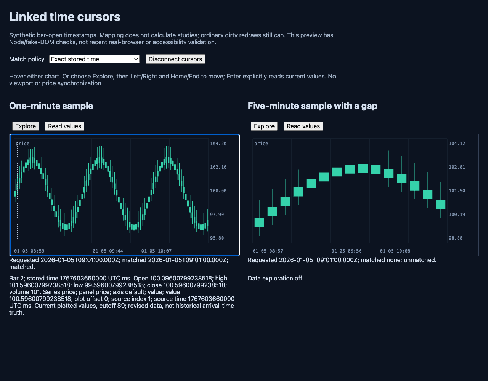
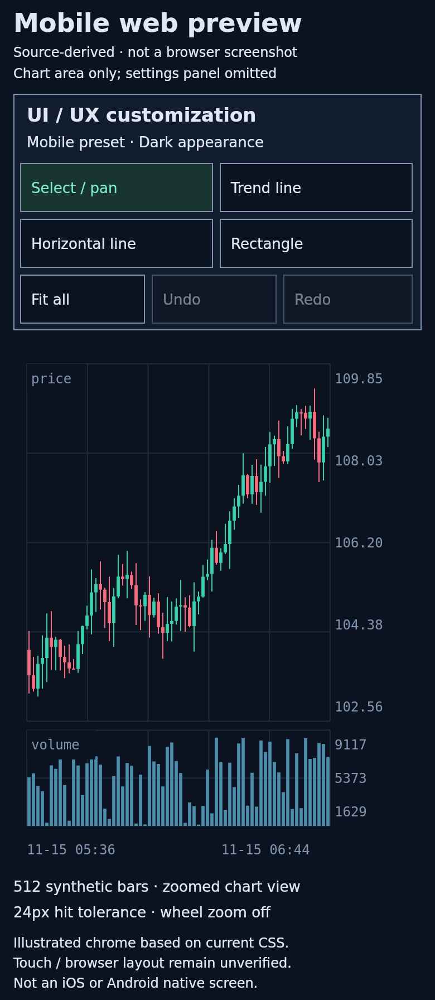
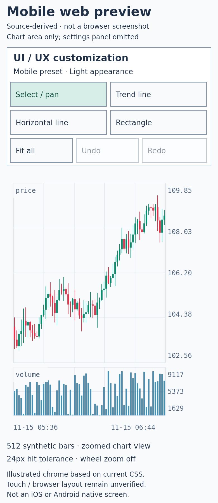

# BaroChart (바로차트)

**Your data. Your chart. Your interface.**

A financial chart library with a DOM-free Float64 core, Canvas/WebGL2 rendering, optional React integration, and Apple/Android native integration paths. Build analysis screens without handing data ownership to a chart service.

[한국어](README.ko.md) · [Quick start](#quick-start) · [Web & mobile gallery](#web--mobile-web) · [API](docs/API.md)

> **Development preview · 0.2.13 · Apache-2.0.** Not published to npm. [Support and validation limits](#support-and-validation).

<p align="center">
<picture>
<source media="(prefers-color-scheme: dark)" srcset="assets/showcase/desktop-dark.png">

</picture>
</p>

A custom web interface built with BaroChart: synthetic candles, EMA overlays, volume and RSI, captured in a real browser. [Run the example](http://127.0.0.1:5173/examples/web/showcase.html) after `npm run demo` · [Capture details](docs/EXAMPLE-SCREENSHOTS.md#current-browser-showcase).

## What is included?

- **Charts and studies:** candles, OHLC, line, area, histogram, multiple panels/price axes, and **35 built-in indicators** including EMA, RSI, MACD, Bollinger Bands, Ichimoku and session-aware VWAP.
- **Drawing and review:** **16 drawing tools**, long/short risk–reward annotations, multi-selection, locking, undo/redo, and manual bar replay with session/bookmark metadata.
- **Your UI:** dark/light themes, colors/fonts, configurable toolbars, explicit desktop/mobile input presets, optional corner overlay slots and a range navigator.
- **Saved charts:** versioned workspaces for chart configuration, indicators, drawings and viewport; a separate codec for input/toolbar preferences. Storage and restore ownership stay with your app.
- **Data-driven integration:** streaming replacements/appends, historical corrections, ingestion queues, OHLCV resampling, linked time cursors/ranges and external trade-ID markers.

Core/web renderers have **no npm runtime dependencies**. React is optional. The library does **not** supply market feeds, broker execution, accounts, journal backends or cloud synchronization. Trade markers display host-owned data; they do not place orders.

## Quick start

Use **Node.js 22+**. No dependency install is required for the plain web demo.

```sh
git clone https://github.com/ictechgy/BaroChart.git
cd BaroChart
npm run demo
```

Open [the main demo](http://127.0.0.1:5173/examples/web/index.html), [minimal first chart](http://127.0.0.1:5173/examples/web/quickstart.html), or [UI customization](http://127.0.0.1:5173/examples/web/customization.html). These are local URLs and work only while your demo server is running. All demo data is **synthetic**, not a live market feed.

## Web & mobile web

### Current browser showcase

The same sample series in two appearances, at a 390px mobile web layout. The desktop image above follows your GitHub theme.

<p>


</p>

Dark / light · actual browser captures of the custom host example. [Source and image hashes](assets/showcase/manifest.json).

<details>
<summary>Earlier captures and source-derived previews</summary>

### Web: actual historical browser capture

Linked one-minute/five-minute views with an explicit stored-time range. This original PNG was captured on **2026-10-14**, macOS Chrome 155.0.8059.79, source **`e3284e54`**. It is not a screenshot of every newer v88 feature.



<details>
<summary>More actual web screens: drawing groups and linked cursors</summary>





</details>

### Mobile web: source-derived UI previews

Dark/light previews at a **390 CSS-pixel layout width**. The chart is rasterized by the production scene/Canvas draw code with synthetic OHLCV; surrounding controls illustrate the mobile preset and customization CSS at the archived revision. **Not browser screenshots, native screens, or proof of touch-device behavior.**

<p>


</p>

Try the same controls in [customization.html](http://127.0.0.1:5173/examples/web/customization.html): choose the mobile preset and narrow the viewport. The preset is explicit, not device detection; the demo moves the toolbar above the chart at ≤920px. [Gallery, provenance and reproduction](docs/EXAMPLE-SCREENSHOTS.md).

</details>

## Your first chart

The runnable [quickstart.html](examples/web/quickstart.html) provides a container with a real height. Its [module](examples/web/quickstart.mjs) is the complete code below; timestamps are UTC Unix **milliseconds**.

```js
import { BarStore, ChartModel, createChart } from '../../src/index.mjs';

const store = new BarStore([
  { time: 1700000000000, open: 100, high: 103, low: 99, close: 102, volume: 500 },
  { time: 1700000060000, open: 102, high: 104, low: 101, close: 103, volume: 650 },
  { time: 1700000120000, open: 103, high: 105, low: 102, close: 104, volume: 700 },
  { time: 1700000180000, open: 104, high: 106, low: 103, close: 105, volume: 800 },
]);
const model = new ChartModel({ store });
model.addSeries({ id: 'price', type: 'candles', panel: 'price' });
model.indicators.add('ema3', 'ema', { period: 3 });
model.addSeries({
  id: 'ema3', type: 'line', panel: 'price',
  indicator: 'ema3', color: '#f0b755',
});
model.fit();
const chart = createChart(document.getElementById('chart'), model, {
  renderer: 'canvas',
});

// Same timestamp replaces the last bar; a later timestamp appends.
store.upsert({
  time: 1700000180000, open: 104, high: 107,
  low: 103, close: 106, volume: 900,
});

// Preserve the chart across back/forward-cache navigation; dispose on exit.
window.addEventListener('pagehide', event => {
  if (!event.persisted) chart.destroy({ disposeModel: true });
});
window.addEventListener('pageshow', event => {
  if (event.persisted && !chart.disposed) chart.resize();
});
```

For component unmount, call `chart.destroy({ disposeModel: true })` only when the chart owns the model. Shared models need a separate final owner; stop your own timers/subscriptions too. Canvas is the default; `renderer: 'webgl2'` opts into WebGL2 with Canvas fallback. Neither renderer guarantees device-independent performance or identical text pixels.

## Install in your application

There is **no published npm release yet**. Make a local source tarball instead of installing an unrelated registry package:

```sh
mkdir -p /tmp/barochart-pack
npm pack --ignore-scripts --pack-destination /tmp/barochart-pack

# Run in your application's directory:
npm install /tmp/barochart-pack/barochart-0.2.13.tgz
```

Then replace the source import with:

```js
import { BarStore, ChartModel, createChart } from 'barochart';
```

TypeScript declarations are included. Entry points: `barochart/core` (DOM-free), `/canvas`, `/webgl`, `/worker`, `/worker-entry`, and optional `/react`. Examples, tests, benchmarks and gallery assets stay in this repository, outside the npm payload.

### React

The compatibility export is still named `AsterChart`:

```jsx
import { AsterChart } from 'barochart/react';

export function PriceChart({ bars }) {
  return <AsterChart data={bars} style={{ height: 420 }} />;
}
```

Your app supplies React 18.3.1/19 and ReactDOM. [React ownership/streaming/SSR contract](docs/REACT.md) · [Runnable TypeScript consumer](examples/react-web/README.md).

## Customize the experience

On a fresh mount, choose a preset and opt into a toolbar:

```js
import { CanvasChart, attachChartToolbar, createChartUIPreset } from 'barochart';

const ui = createChartUIPreset('mobile');
const chart = new CanvasChart(chartElement, readyModel, {
  interaction: ui.interaction,
});
const toolbar = attachChartToolbar(emptyToolbarElement, chart, ui.toolbar);
toolbar.setOptions({labels: {select: 'Pan', fit: 'Fit view'}});
```

- Mobile: 24px hit tolerance, wheel zoom off, comfortable horizontal controls. Comfortable toolbar buttons have a **44px minimum width and height** before host restyling.
- Change theme, font, toolbar content/order/density, panel height ratios and price-axis side. Add [overlay slots](docs/CHART-OVERLAYS.md), [navigator](docs/CHART-NAVIGATOR.md) or [trade markers](docs/TRADE-MARKERS.md) only when needed.
- The customization studio explicitly saves/loads **appearance profiles** via localStorage and imports/exports JSON. No automatic persistence; profiles include colors, panel layout, placement, input, toolbar captions and optional displays, while drawings and data stay in the chart. Compose [UI state](docs/WEB-UI-STATE.md) with [workspaces](docs/WORKSPACES.md) for host-owned saved charts.
- Move indicator groups between panels, overlay them on independent or shared axes, split into a new panel, and reorder panels in the main demo. [Indicator placement API and drawing preservation](docs/INDICATOR-PLACEMENT.md).
- Edit button captions, undo/redo up to 30 settings changes independently of drawing history, and copy a JavaScript/TypeScript chart module from the studio. Run `npm run test:customization:browser` for the maintained Chrome checks.
- Keyboard options are enable switches, **not shortcut remapping**. Arbitrary panel docking and native UI parity are not included. [Full customization contract](docs/WEB-CUSTOMIZATION.md).

## Examples and guides

| Explore | Local example | Contract |
| --- | --- | --- |
| Manual replay and bookmarks | [Bar replay](http://127.0.0.1:5173/examples/web/bar-replay.html) | [Prefix-only replay](docs/BAR-REPLAY.md), no autoplay |
| Relative performance | [Comparison](http://127.0.0.1:5173/examples/web/comparison.html) | [Explicit baseline/alignment](docs/RELATIVE-COMPARISON.md) |
| Linked views | [Time ranges](http://127.0.0.1:5173/examples/web/linked-ranges.html) · [cursors](http://127.0.0.1:5173/examples/web/linked-cursors.html) | [Time ranges](docs/TIME-RANGE.md) · [shared model ownership](docs/SHARED-MODEL-REFRESH.md) |
| Drawing workflows | [Drawing groups](http://127.0.0.1:5173/examples/web/drawing-groups.html) | [Style presets](docs/DRAWING-STYLE-PRESETS.md) · [risk/reward](docs/POSITION-DRAWINGS.md) |
| Batched live updates | [Ingestion queue](http://127.0.0.1:5173/examples/web/ingestion-queue.html) | [Host-owned data ingestion](docs/INGESTION.md) |
| Data and analysis | [Analysis](http://127.0.0.1:5173/examples/web/analysis.html) | [Indicators](docs/INDICATORS.md) · [ingestion](docs/INGESTION.md) · [resampling](docs/RESAMPLING.md) |

[API/lifecycle](docs/API.md) · [Data rules](docs/DATA.md) · [Independent axes](docs/INDEPENDENT-AXES.md) · [Architecture](docs/ARCHITECTURE.md) · [Contributing](CONTRIBUTING.md)

## Support and validation

| Integration | What exists | Important boundary |
| --- | --- | --- |
| Plain web | Canvas/WebGL2 and HTML controls | Selected historical Chrome flows checked; newer UI/device behavior needs browser QA |
| React web | Optional `AsterChart` adapter | Latest modeled-hook tests do not establish React runtime/SSR behavior |
| Mobile web | Explicit input preset and responsive example CSS | Preview images are illustrations; touch, scrolling and assistive technology remain unverified |
| Apple native | JavaScriptCore/CoreGraphics, SwiftPM | [Swift SDK](docs/SWIFT-SDK.md); recent host changes need actual SDK/device validation |
| Android native | QuickJS/JNI/Canvas, library/AAR path | [Android SDK](docs/ANDROID-SDK.md); recent host changes need actual SDK/device validation |

Native paths are not WebViews. React Native/Flutter adapters are not supplied. Legacy API/schema names (`AsterChart`, `AsterNative`, `AsterEngine`, `dev.aster.charts`, `aster.*`) remain for compatibility; do not rename serialized schemas.

Node contract tests, strict TypeScript and offline packed-consumer checks are automated checks, not browser/device certification. Float64 is not arbitrary-precision decimal arithmetic; workspaces need matching host-provided data; workers still incur snapshot/allocation costs. [Full validation history and limits](docs/PUBLIC-VALIDATION.md) · [state/ownership roadmap](docs/MARKET-ROADMAP.md).

<details>
<summary>Earlier validation records, including the retained failure</summary>

At source `381fb00fc41c49aadfb72f45fb0c0a66f500d62c` (2026-10-18), **4,870/4,870 Node tests**, 513 ESM syntax checks, strict TypeScript 5.9.3 and an offline packed-consumer check passed. These are cloud Node/modeled-host results; no new browser/native SDK run is implied. See the [dated validation entries](docs/PUBLIC-VALIDATION.md) for scope and retained earlier failures.

The pre-branding Linux/Node baseline passed **2,551 of 2,552 tests**. One dry-run CLI hit a 15-second watchdog; its unchanged test file then passed **131/131** in isolation. The full-suite failure remains unresolved. This is not an all-green release certification.

Mac Chrome 155 checks cover the drawing panel, linked cursors, keyboard exploration and one Canvas/WebGL round trip. Screen readers, other browsers and long-running rendering remain unverified. Standalone QuickJS tests and Java tests using stubbed Android types do not substitute for native SDK builds or device runs. There is no verified claim of universal performance, commercial-product parity or physical-device FPS.

</details>

```sh
npm test
npm run check
# With an installed TypeScript 5.9+ compiler:
TSC_PATH=/path/to/typescript/lib/tsc.js npm run check:types
TSC_PATH=/path/to/typescript/lib/tsc.js npm run check:package
```

These local commands do not publish anything. Browser/native scripts require their documented browsers, SDKs and permissions.

## License

[Apache License 2.0](LICENSE) · [NOTICE](NOTICE) · [Third-party components](docs/LICENSING.md). The package remains `private: true`; this README does not announce a registry release.
