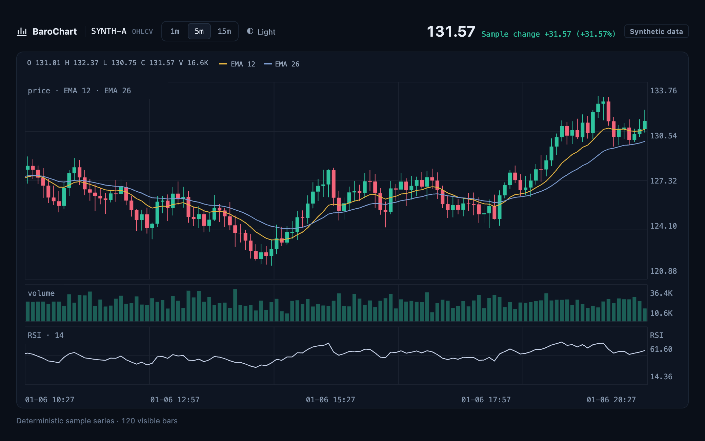

# Web screenshots and mobile web previews

## Current browser showcase

The current gallery contains actual browser captures of the included [`showcase.html`](../examples/web/showcase.html) custom host example. It renders the production Canvas chart with synthetic data; the surrounding controls belong to that example. Desktop framing is 1040 × 650 CSS pixels and mobile is 390 × 780, both captured at 2×. These are web screenshots, not native iOS or Android screens.

Claude proposed **Instrument Panel**, a dark, chart-first composition, and **Specimen Plate**, a light technical-figure treatment. The implemented direction is Instrument Panel, with matching dark/light geometry, compact controls and a restrained palette. Displayed prices and OHLCV values come from the deterministic series.



<p>


</p>

Run `npm run demo` and open the [showcase](http://127.0.0.1:5173/examples/web/showcase.html). Its interval and theme controls work; 1/5/15-minute candles are host-aggregated from the same synthetic source. The [manifest](../assets/showcase/manifest.json) records source hashes, capture environment, dimensions and image hashes.

With `agent-browser` and a local Chromium browser already installed, regenerate all four screenshots with:

```sh
node scripts/capture-showcase.mjs
```

The script starts a temporary loopback server and an isolated browser session, waits for fonts and chart rendering, checks the two themes use identical data, and saves original element-screenshot PNG bytes. It checks for overflow and external resource requests. `CHROME_BIN` can select a local browser; an optional output-directory argument keeps trial captures separate. No dependencies are installed and no image editing is applied. Font/browser differences can change pixels across machines.

## Historical captures and source-derived previews

The three web screenshots below are original PNG captures from **Google Chrome 155.0.8059.79 on macOS**, using an isolated headless browser with actual DOM and Canvas rendering on **2026-10-14 UTC**. The data is synthetic. The source revision was [`e3284e54b638b8a373311ef3788fcff003f6477a`](https://github.com/ictechgy/BaroChart/commit/e3284e54b638b8a373311ef3788fcff003f6477a). The PNG bytes have not been edited or regenerated.

The captured run checked restored pages after back/forward navigation. These historical images show that revision, not an execution of the latest source. Text inside an image may retain the validation notice that existed when it was captured. The run does not establish native SDK/device support, screen-reader accessibility, display latency, FPS or competitive performance. See [current validation scope](PUBLIC-VALIDATION.md).

## Web: linked stored-time ranges

One-minute and five-minute synthetic candles with a gap; keyboard pan/zoom and absolute-time mapping were exercised after page restoration.


Run `npm run demo` from the repository root, then open [the linked-range example](http://127.0.0.1:5173/examples/web/linked-ranges.html).

## Web: drawing groups

The real checkbox panel, batch deletion, Undo and focus restoration were exercised after back/forward navigation. This image shows the page after Undo.


Open [the drawing-group example](http://127.0.0.1:5173/examples/web/drawing-groups.html) on the same demo server.

## Web: linked cursors and value readouts

The restored charts retained their original model/canvas objects. Pointer mapping and explicit keyboard value reads were exercised.


Open [the linked-cursor example](http://127.0.0.1:5173/examples/web/linked-cursors.html).

## Mobile web: source-derived previews, not screenshots

These dark/light illustrations use a 390 × 896 logical-pixel layout, saved as 780 × 1792 PNGs at 2×. The chart area is produced by the actual `buildScene` and `renderCanvas` code with 512 seeded synthetic OHLCV bars, a 69-bar visible range, candle/volume panels and current theme values. Source basis: [`01e4e1a`](https://github.com/ictechgy/BaroChart/commit/01e4e1a83a560552c0e0274eaa685befced67412), generated on 2026-10-22.

<p>


</p>

The surrounding controls are drawn illustrations based on [customization CSS](../examples/web/customization.css) and `createChartUIPreset('mobile')`, not computed browser layout. The desktop settings panel is omitted and toolbar labels are shortened. Undo/Redo are shown disabled because there is no drawing history. The mobile preset opts into 24px hit tolerance, wheel zoom off and a comfortable horizontal toolbar; it does not detect devices automatically. These images do not establish browser layout, touch scrolling, keyboard focus, assistive-technology behavior, performance or native SDK support.

Try the real example with `npm run demo`, open [UI customization](http://127.0.0.1:5173/examples/web/customization.html), choose the mobile preset, and narrow the viewport. The example CSS places the toolbar above the chart at widths ≤600px. The full settings controls remain part of that example. See [UI customization and its limits](WEB-CUSTOMIZATION.md).

### Preview regeneration and integrity

[Preview manifest](../assets/previews/manifest.json) is separate from the historical [screenshot manifest](../assets/screenshots/manifest.json). It records source-file hashes, scene hashes, image hashes, dimensions, the actual preset and limitations. No original screenshot has been changed.

The optional documentation generator [readme-previews.mjs](../scripts/readme-previews.mjs) uses `@napi-rs/canvas` 0.1.100 as its Node raster backend, with DejaVu Sans/DejaVu Sans Mono fonts. With that development-only backend available to Node, run:

```sh
node scripts/readme-previews.mjs
node --test test/readme-gallery.test.mjs test/readme-previews.test.mjs
```

The backend is not a library runtime dependency and is not needed to run the demos, consume BaroChart, or verify the committed image/scene hashes. Font/backend changes can alter output bytes; the generator is a reproducible source description, not a cross-platform pixel guarantee. Normal tests do not install or execute the optional raster backend.

## Other platform examples

| Platform | Example / how to run | Screenshot and verification status |
|---|---|---|
| React web | [Pinned React example](../examples/react-web/README.md): `cd examples/react-web`, `npm ci`, `npm start` | No verified screenshot retained for this React consumer; the images above are the plain web examples. |
| macOS native | [SwiftPM consumer](../examples/swift-consumer/README.md): `swift run --package-path examples/swift-consumer --scratch-path /tmp/aster-sdk-manual AsterSDKProbe` | No verified native screenshot retained. The command is a consumer probe, not a screenshot generator; recent host changes have not been compiled/run with Apple SDKs here. |
| iOS native | Open the [consumer Xcode project](../examples/swift-consumer/iOS/AsterSDKConsumer.xcodeproj/project.pbxproj), use its shared scheme with an installed simulator; [Swift SDK guide](SWIFT-SDK.md) | No verified iOS screenshot retained. Recent host changes and physical-device execution remain unverified. Requires the user's own Xcode/runtime setup. |
| Android native | [Android SDK / Kotlin consumer instructions](ANDROID-SDK.md), including explicit installed SDK/NDK and selected emulator/device | No verified Android screenshot retained. Recent host changes have not been built/run against the actual Android SDK/JNI/device here. |

Apple uses JavaScriptCore/CoreGraphics; Android uses QuickJS/JNI/Android Canvas. These are native renderer paths, not WebViews. A web screenshot is not evidence of those paths. The current showcase uses an installed Chromium browser; no native SDK installation, simulator run or physical-device execution is required for these captures.

[Image manifest](../assets/screenshots/manifest.json) records source revision, capture environment, dimensions and SHA-256 for each image. Images are repository documentation assets and are excluded from the npm package; raw QA logs and private machine metadata are not included.
